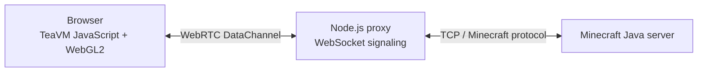

# c-browser

<p align="center">
  <strong>A Minecraft Java 1.21.1 client experiment for the browser.</strong><br>
  Java → TeaVM → JavaScript, with WebGL2 rendering and a WebRTC-to-TCP bridge.
</p>

<p align="center">
  
  
  
  
  
  
</p>

**c-browser** explores what it takes to run a Minecraft Java client in a normal web browser. The project compiles Java code with [TeaVM](https://teavm.org/), uses WebGL2 for browser-side graphics, and transports Minecraft protocol traffic through a WebRTC DataChannel connected to a small Node.js TCP proxy.

> [!IMPORTANT]
> This is an **experimental work in progress**, not a finished or fully compatible Minecraft client. Chunk decoding, server-authoritative movement, block interaction, inventory handling, and end-to-end gameplay validation are still being developed. Expect bugs and incomplete features.

## How it works



The browser hosts the client runtime and renderer. The proxy handles WebRTC signaling and relays DataChannel bytes to a Minecraft server over TCP. For local development, the proxy is configured around an isolated test server on port `25620`.

## What is in the project?

| Area | Location | Purpose |
|---|---|---|
| TeaVM client | `src/main/java/poc/` | Browser bootstrap, networking bridge, render loop, WebGL interop and packet utilities |
| Browser gameplay | `webport/js/` | First-person camera, player movement, chunk rendering and game-loop modules |
| Browser shell | `webport/` | HTML entry point and generated TeaVM output |
| WebRTC/TCP proxy | `server/` | Signaling, DataChannel relay and TCP forwarding |
| Minecraft support plugin | `browser-minecraft-support/` | Companion Bukkit/Spigot/Paper server plugin |
| Class patching | `patch/` | Patcher3 integration and stub generation |
| Java API stubs | `stubs-src/` | Stub implementations needed by the TeaVM target |
| Tests | `tests/` | Protocol, unit, integration and browser test scripts |
| Dashboard | `dashboard/` | Activity dashboard and watchdog utilities |
| Docs | `docs/` | Supporting documentation and signaling references |

## Current state

The project has working pieces, but **a successful build or an open WebRTC connection does not by itself mean the game is playable**. The following is a development snapshot, not a claim that every feature has passed an end-to-end browser test.

| Feature | State | Notes |
|---|---|---|
| WebRTC signaling and DataChannel bridge | Implemented / testable | Browser-to-proxy transport; verify against the current test setup |
| TeaVM browser bootstrap | In place | Builds Java client code for the browser; build/runtime compatibility still needs validation |
| WebGL2 renderer | In progress | Browser renderer and instanced chunk-rendering module exist |
| First-person camera | In progress | Pointer-lock and mouse-look module exists; verify in-browser |
| Local player movement | In progress | WASD, jump and gravity logic exist; server reconciliation is not complete |
| Chunk data | Incomplete | Initial 1.21.1 chunk parsing exists; full palette/bit-packed block-state decoding remains |
| Collision | In progress | Depends on correct decoded world/block data |
| Server-authoritative movement | Incomplete | Position/look packet handling and correction need completion and testing |
| Block breaking / placing | Not complete | Raycasting and interaction packets remain |
| Hotbar / inventory | Not complete | Still to be implemented |
| Performance | Not benchmarked | FPS and frame-time targets must be measured on real hardware |

### Next milestones

1. Finish and test the Minecraft 1.21.1 chunk section and palette decoder.
2. Render real server-provided terrain at the correct world coordinates.
3. Complete server-authoritative movement, including position corrections.
4. Add block targeting, breaking, placing and basic hotbar/inventory support.
5. Measure frame time and optimize chunk meshing, culling and draw calls.

## Requirements

- JDK 21
- Maven 3.9+
- Node.js 20+
- A Minecraft Java 1.21.1 server for local testing (not included)
- Official Mojang mappings and any required client/server artifacts, acquired separately and used subject to their terms
- A modern browser with WebRTC and WebGL2 support

## Build the TeaVM client

From the repository root:

```bash
mvn clean package -Pteavm
```

The build is intended to:

1. Run the Patcher3/deobfuscation pipeline.
2. Compile the TeaVM target sources.
3. Generate `webport/classes.js` and supporting browser output.

Build success can depend on the Minecraft artifacts, mappings, stubs and TeaVM compatibility in the local environment. A successful JavaScript generation step is not an end-to-end gameplay test.

## Run locally

Use an **isolated test server**. The example setup expects a Purpur-compatible server configured on port `25620`; its JAR, world and `server.properties` are not distributed here.

### 1. Start the test server

Configure your local test server to listen on port `25620`. For the intended offline-mode development setup, the test server may use `online-mode=false` in a private, isolated environment.

### 2. Start the proxy

In a second terminal, from the repository root:

```bash
node server/webrtc_proxy.js
```

The signaling service listens on port `8766` and the proxy forwards the Minecraft stream to the configured TCP test-server target (normally `127.0.0.1:25620`). Check `server/webrtc_proxy.js` if your local ports or bind addresses differ.

### 3. Serve the browser client

In another terminal:

```bash
python3 -m http.server 9091 --directory webport
```

Open [http://127.0.0.1:9091/index.html](http://127.0.0.1:9091/index.html) in a WebRTC- and WebGL2-capable browser, then use the page's connection controls.

For automated runs, the page also recognises `?auto=1`:

```text
http://127.0.0.1:9091/index.html?auto=1
```

## Tests

Run tests from the repository root. The protocol tests are the quickest starting point:

```bash
node tests/protocol/test-netbridge-packets.js
node tests/protocol/test_send_packets.js
node tests/protocol/test_join.js
```

Integration tests may require the proxy and isolated Minecraft test server to be running:

```bash
node tests/integration/test_e2e_complete.js
node tests/integration/test_full_pipeline.js
node tests/integration/test_pipeline_simple.js
```

Browser tests require the relevant browser automation/CDP setup as well as the running services:

```bash
node tests/browser/test_browser.js
node tests/browser/test_browser_join_v3.js
```

A passing syntax check or an individual protocol test does not prove that terrain renders or that gameplay is synchronized with a server. Record browser console output, proxy logs and server logs when validating an end-to-end change.

## Companion server plugin

The optional companion plugin lives in `browser-minecraft-support/`. Build it with:

```bash
cd browser-minecraft-support
mvn clean package
```

The plugin is a separate server-side component. Review its source and permissions before installing it on any server.

## Development notes

### Main TeaVM components

- **`ClientMain`** — browser-side client bootstrap.
- **`NetBridge`** — packet framing, dispatch and VarInt utilities.
- **`JsNetBridge`** — JavaScript interop used by the TeaVM runtime.
- **`MinecraftClientConnection`** — connection/handshake integration.
- **`PacketPool`** — byte-buffer reuse intended to reduce allocation pressure.
- **`GlStateManager` / `RenderLoop`** — rendering bridge and frame loop.

### Browser modules

- **`camera.js`** — camera matrices, pointer lock and mouse look.
- **`player.js`** — input, movement, gravity and collision logic.
- **`chunkRenderer.js`** — chunk packet parsing and WebGL2 terrain rendering.
- **`game.js`** — connects the gameplay modules and drives update/render frames.

### Adding tests

Keep tests in the matching `tests/` area:

- `tests/unit/` — fast, isolated logic tests.
- `tests/protocol/` — packet encoding and decoding.
- `tests/integration/` — proxy/server pipeline tests.
- `tests/browser/` — browser automation and runtime checks.

### Editing the Java client

Edit TeaVM target code under `src/main/java/poc/`, then rebuild:

```bash
mvn process-classes -Pteavm
```

### Editing the companion plugin

Plugin sources are under `browser-minecraft-support/src/main/java/io/browserminecraft/`.

## Security and compatibility

- Keep the test server private and isolated. **Do not expose an offline-mode server to the public internet.** Offline mode does not authenticate player identities.
- Do not point the development proxy at a production server. The documented local test port is `25620`.
- This project does not bypass Mojang/Microsoft authentication and is not intended to circumvent online-mode server protections. Use only servers you own or are explicitly authorised to test.
- Do not expose the signaling/proxy service publicly without adding appropriate access controls, network restrictions and abuse protection.
- Compatibility is focused on Minecraft Java **1.21.1** (protocol version **767**); other versions are not guaranteed.

## License and third-party software

Original project code is released under the **MIT License**; see [`LICENSE`](LICENSE). This grant applies only to code and other material that the relevant contributors are entitled to license. It does **not** grant rights to Minecraft or Mojang/Microsoft-owned code, assets, names or trademarks, nor to third-party dependencies or other separately licensed material. Those remain subject to their own terms. See the license notice for details.

c-browser is an unofficial community project and is **not affiliated with, endorsed by, or sponsored by Mojang Studios or Microsoft**. Minecraft is a trademark of Microsoft Corporation.
